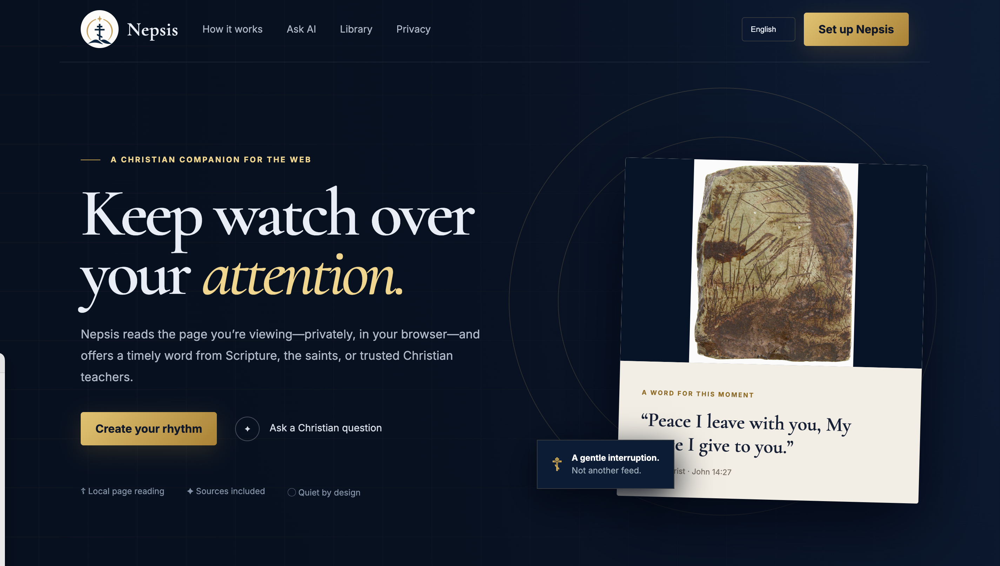

# Nepsis

**A local-first browser extension for bringing reflection into everyday reading.**

[Visit Nepsis](https://nepsis.site) · [View Dylan's portfolio](https://dylanfox.work)

## The product

Nepsis privately reads the open page and offers a timely Christian reflection drawn from Scripture and curated Orthodox sources. It is designed to create a brief, thoughtful pause without pulling the user away from what they are doing.

## What I built

- Local page understanding designed around user privacy
- A matching experience that connects reading context with curated material
- An extension interface that stays focused and unobtrusive
- A supporting website for product education and distribution
- Content validation and release workflows

I led the product concept, experience design, content system, implementation, and launch.

## Repository note

This is a public product showcase. Production source code, matching logic, curated content systems, and infrastructure are maintained privately.

© 2026 Dylan Fox. All rights reserved.
